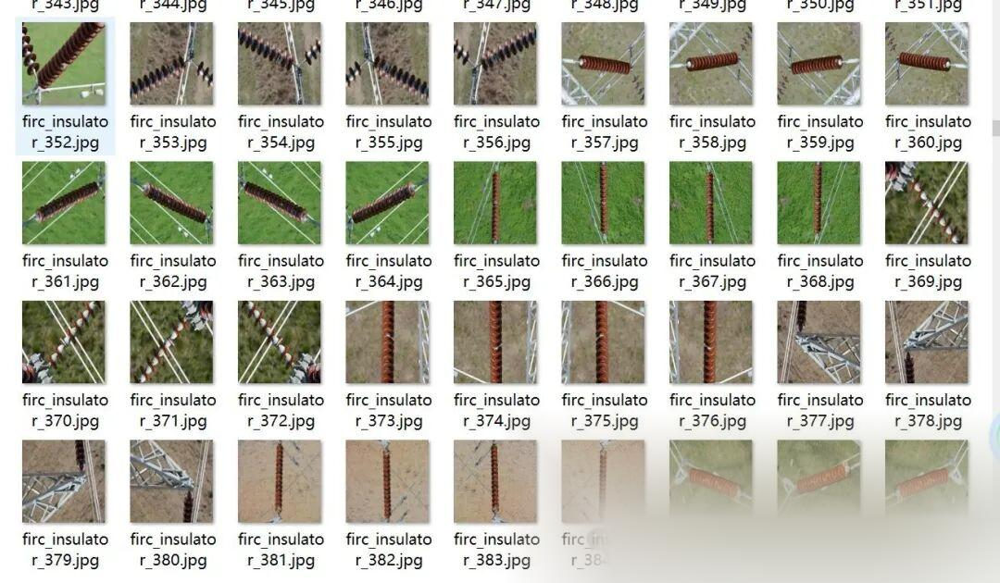
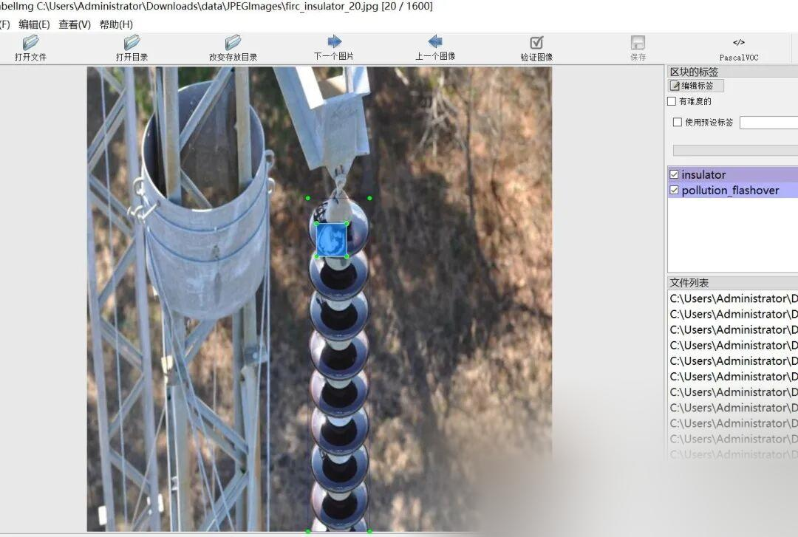

# Power Scene Insulator String Flashover and Corruption Detection Data Set in VOC+YOLO format with 1600 images across 3 categories

The dataset is approximately 1/4 of the original image, with the remaining being enhanced images.

Dataset format: Pascal VOC format + YOLO format (txt file without split path, only containing jpg images and corresponding VOC format xml files and yolo format txt files)

Number of images (number of jpg files): 1600

Number of annotations (number of xml files): 1600

Number of annotations (number of txt files): 1600

Label category count: 3

Label category names (note that the order of categories in the YOLO format does not correspond to this, but is based on the labels folder's classes.txt): ["crack", "insulator", "pollution_flashover"]

Number of boxes labeled in each category:

Crack Frames = 1093

Insulator frame count = 1832

pollution_flashover box count = 2448

Total frame count: 5373

Using labelImg:

Annotation rules: Draw a rectangle around the category.

Important Notice: No

Special : This dataset does not guarantee the accuracy or precision of the trained models or weight files. The dataset is provided with accurate and reasonable annotations only.

Image Preview:

Annotation example:

## Payment

Here is a pay link on Stripe ( https://buy.stripe.com/3cs8yP7sY87d0vu9AB ). Please contact me lonlonago@foxmail.com after funding $89, and I will send you a complete data files , thank you!

